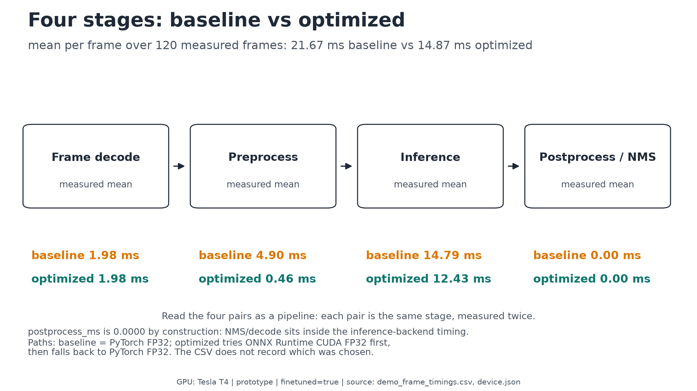
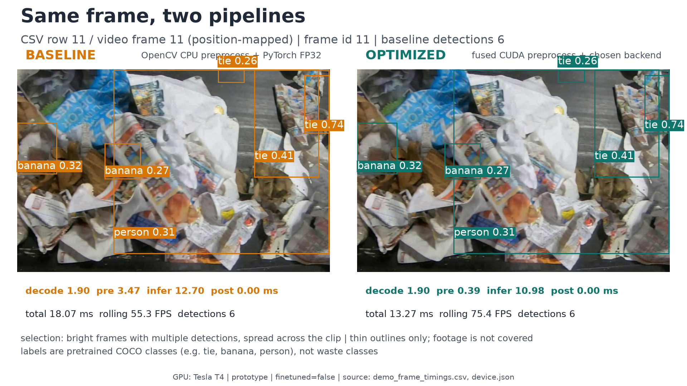
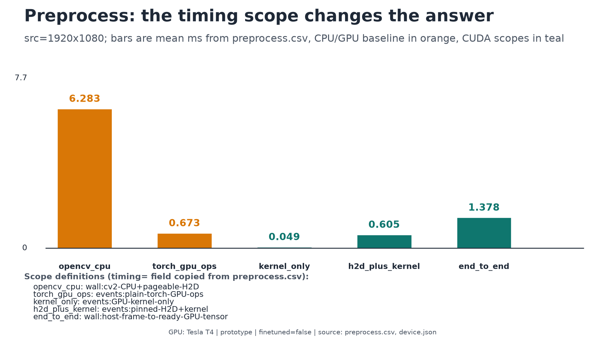
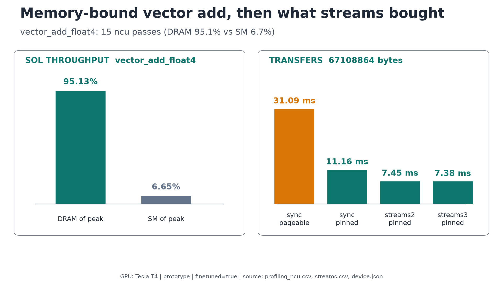
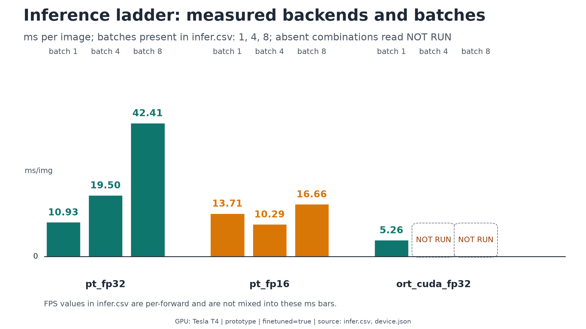
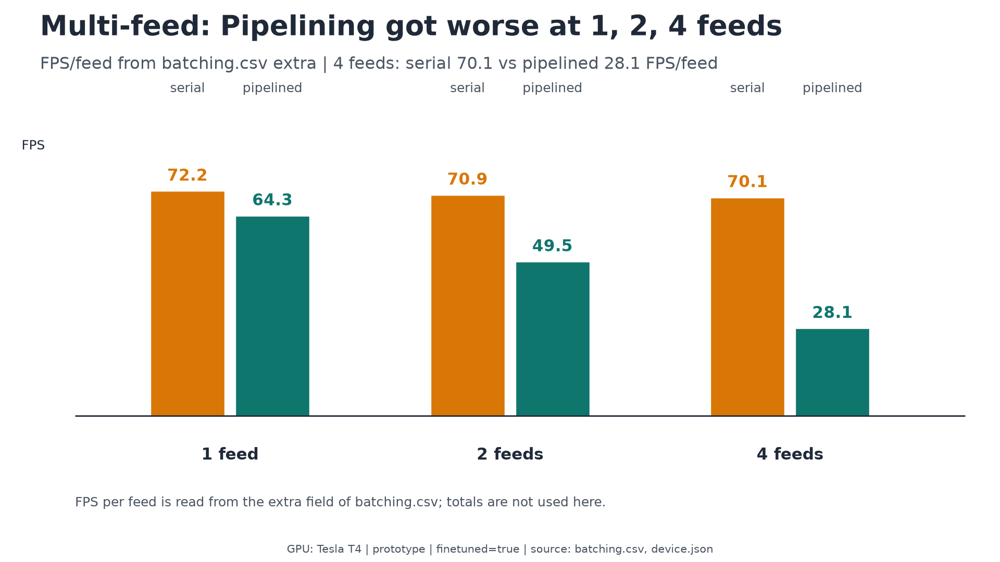
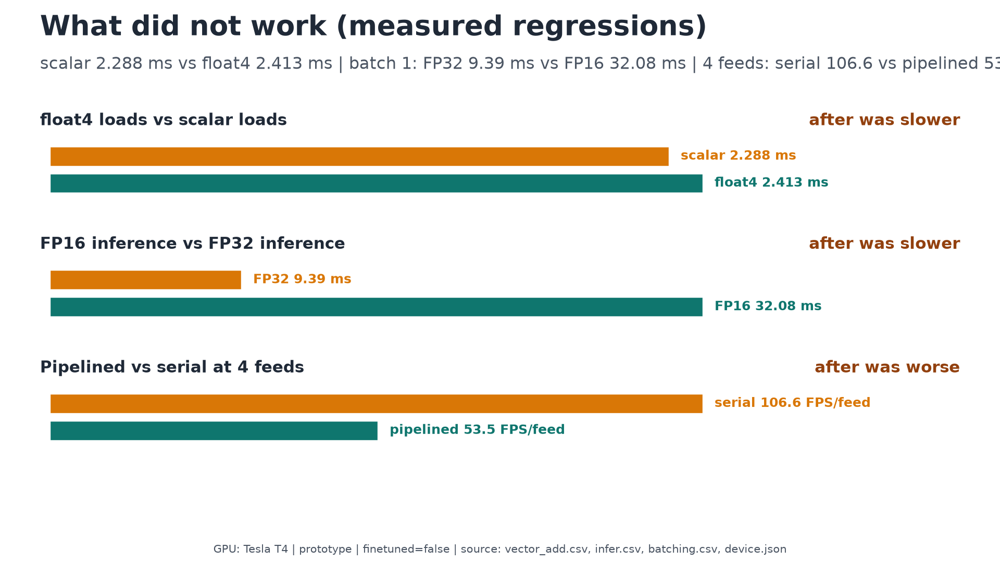
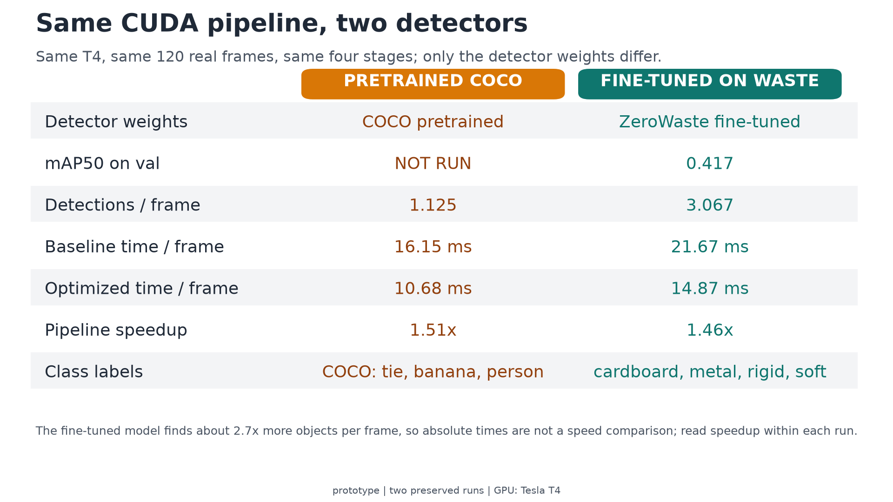

# CUDA Conveyor Waste Detection Pipeline

A CUDA performance study of a conveyor-belt waste detector on a Tesla T4: hand-written GPU kernels, a fine-tuned YOLOv8n, and profiling that shows what got faster, what did not, and why.

**Status: prototype.** Built to learn and show GPU engineering with real measurements. It is not a deployed system.


---

## TL;DR

- **What it is:** a four-stage video pipeline (decode, preprocess, inference, postprocess) for waste on a conveyor belt, with each stage timed and optimized on the GPU.
- **Main result:** preprocessing went from 4.90 ms to 0.46 ms per frame, and the whole pipeline went from 46.1 to 67.3 FPS (1.46x), measured over 120 real frames.
- **What limits it now:** Inference now dominates at 12.43 ms per frame, against 0.46 ms for preprocess.
- **Detector:** YOLOv8n fine-tuned on 1415 ZeroWaste images, mAP50 0.4173 on 300 held-out val images. This is a small subset and a short fine-tune, so treat the detector as a working placeholder, not a finished model.
- **Honest negatives:** float4 no faster at the bandwidth ceiling, FP16 slower only at batch 1, pipelining regressed at 2 and 4 feeds, TensorRT unavailable.

---

## Why this project exists

Recycling lines need to spot and sort waste fast. Before any model can run, every camera frame has to be decoded, resized, color-converted, normalized and copied to the GPU. At high frame rates, that plumbing can cost as much as the model itself.

This project takes one realistic pipeline and asks a simple question: **where does the time go, and which GPU techniques actually pay off?** Each technique is built, checked for correctness, timed with proper methodology, and reported even when it did not help.

**What this project is not:** a state-of-the-art detector, a production system, or a robotics integration. The footage is stitched still frames from the val split, not consecutive video; 450 bright frames kept, 450 near-black source frames dropped.

---

## The pipeline


| Stage | Input | Output | Baseline | Optimized | Baseline ms | Optimized ms |
|---|---|---|---|---|---|---|
| Decode | video file | uint8 HWC frame | OpenCV (CPU) | OpenCV (CPU) | 1.98 | 1.98 |
| Preprocess | uint8 HWC frame | NCHW float32 tensor on GPU | OpenCV on CPU, then upload | one fused CUDA kernel | 4.90 | 0.46 |
| Inference | preprocessed tensor | raw predictions | PyTorch FP32 | ONNX Runtime CUDA FP32 preferred, falls back to PyTorch FP32 (choice not recorded in CSV) | 14.79 | 12.43 |
| Postprocess | raw predictions | boxes, classes, scores | NMS inside inference | NMS inside inference | 0.00 | 0.00 |

Mean per frame over 120 frames on Tesla T4. Baseline and optimized both run model inference on the GPU. The difference is preprocessing, the inference backend, and pipelining.



---

## Results at a glance

| What | Baseline | Optimized | Change | Image |
|---|---|---|---|---|
| End-to-end FPS (120 real frames) | 46.1 | 67.3 | 1.46x | [04](docs/ppt_pack/04_end_to_end_fps.png) |
| Time per frame | 21.67 ms | 14.87 ms | 1.46x | [03](docs/ppt_pack/03_latency_breakdown.png) |
| Preprocess, full path from host frame to GPU tensor | 7.20 ms (OpenCV CPU) | 1.42 ms (fused kernel) | 5.05x | [06](docs/ppt_pack/06_preprocess_honest.png) |
| Preprocess, kernel only | 0.68 ms (plain PyTorch GPU ops) | 0.05 ms | 1.22x | [06](docs/ppt_pack/06_preprocess_honest.png) |
| Reduction, 16.7M floats | 21.68 ms (naive) | 0.29 ms (warp shuffle) | 74.15x, CUB library: 0.26 ms | [07](docs/ppt_pack/07_kernels_reduction_matmul.png) |
| Matmul, N=1024 | 706 GFLOPS (naive) | 824 GFLOPS (tiled) | cuBLAS: 6017 (14% reached) | [07](docs/ppt_pack/07_kernels_reduction_matmul.png) |
| Host to GPU copy + kernel, 64 MB | 31.09 ms (pageable) | 7.38 ms (streams3_pinned) | 4.21x | [08](docs/ppt_pack/08_memory_bound_and_streams.png) |
| Detector quality (val) | | mAP50 0.4173, mAP50-95 0.324682 | | [11](docs/ppt_pack/11_detection_quality.png) |

**Reading this table honestly:** The 1.46x end-to-end gain comes from preprocess and inference together; preprocess alone cannot explain it (Amdahl's law).

---

## Same frame, two pipelines

Both panels use the same real frame and the same fine-tuned detector. Left is the baseline, right is the optimized path.



Boxes agree on 100.0% of frames (mean IoU 1.000 over matched boxes). All frames where the detector found boxes agree; frames where both pipelines found nothing are excluded because IoU 0 there is a definition artefact.

---

## What I built

### 1. Fused preprocess kernel

**Problem.** A camera frame arrives as `uint8` in height-width-channel order, BGR. The model wants a `NCHW float32` tensor, RGB, scaled to 0 to 1, in channel-first order, letterboxed to 640x640. Done step by step, each step reads and writes the whole image again.

**Approach.** One CUDA kernel does resize (bilinear), letterbox padding, BGR to RGB, normalize, and HWC to CHW in a single pass. Each GPU thread computes one output pixel, so memory is touched once.

**Measured** (source image 1920x1080, benchmark iterations in preprocess.csv runs, mean):

| Variant | Scope | ms |
|---|---|---|
| `opencv_cpu` | CPU resize and convert, then pageable upload | 7.20 |
| `torch_gpu_ops` | same steps as plain PyTorch GPU ops | 0.68 |
| `kernel_only` | fused kernel, input already on GPU | 0.05 |
| `h2d_plus_kernel` | pinned upload plus fused kernel | 0.56 |
| `end_to_end` | host frame to ready GPU tensor | 1.42 |

**Correctness.** Output matches the CPU reference within atol=0.0001/rtol=0.0001 (max abs error 4.768372e-07). Timing was only trusted after this check passed.

The end-to-end win over OpenCV is 5.05x, but the fused kernel is only 1.22x over plain PyTorch GPU ops with upload - most of the win is moving to the GPU.



Code: `phase_b/preprocess.cu`, `phase_b/preprocess_ext.py`.

### 2. Parallel reduction

**Problem.** Sum 16.7 million floats. Easy to write, easy to write slowly.

**Three versions.**
- **Naive global:** threads add straight in global memory, with many round trips and many synchronizations.
- **Shared memory:** each block reduces in fast on-chip shared memory and writes one partial result.
- **Warp shuffle:** threads in a warp exchange values in registers with no shared memory and no block-wide sync for the last steps.

| Variant | ms | GB/s |
|---|---|---|
| naive global | 21.68 | 3.10 |
| shared memory | 0.29 | 232.56 |
| warp shuffle | 0.29 | 229.58 |
| CUB (NVIDIA library, reference) | 0.26 | 258.05 |

The naive version is deliberately slow, so the comparison that matters is against CUB: my best kernel is within 112% of it. Shared memory and warp shuffle are within a few percent of each other and reach 112% of CUB's throughput.

Code: `phase_a/reduction.cu`.

### 3. Matrix multiply

Naive, 32x32 shared-memory tiled, and cuBLAS as the ceiling.

| N | naive GFLOPS | tiled GFLOPS | cuBLAS GFLOPS | tiled vs cuBLAS |
|---|---|---|---|---|
| 1024 | 706 | 824 | 6017 | 14% |

Tiling helps less than the textbook suggests here. What is missing compared with cuBLAS: register blocking, vectorized loads, double buffering, and tensor cores. The gap to cuBLAS is register blocking, vectorized loads, double buffering and tensor cores.

Code: `phase_a/matmul.cu`.

### 4. Memory-bound kernels (vector add)

Vector add does one addition for every 12 bytes moved, so it is limited by memory bandwidth, not compute. Nsight Compute confirms it: DRAM throughput 95.1% of peak, SM throughput 6.7% of peak. float4 reached 253.11 GB/s versus 261.86 GB/s for scalar loads - no win, because the kernel is already at the memory-bandwidth ceiling.



Code: `phase_a/vector_add.cu`.

### 5. Pinned memory and streams

Copying from normal (pageable) host memory is slow because the driver stages it first. Pinned memory skips that, and multiple CUDA streams let copies and kernels overlap.

| Variant | ms |
|---|---|
| sync, pageable | 31.09 |
| sync, pinned | 11.16 |
| 2 streams, pinned | 7.45 |
| 3 streams, pinned | 7.38 |

Pinned memory alone gives 2.79x; multiple streams add only 1.51x on top.

Code: `phase_a/streams.cu`.

### 6. Inference backends

Same fine-tuned YOLOv8n, different runtimes, batch sizes 1, 4, 8. Times are **ms per forward of the stated batch, including decode/NMS and device-to-host copy (fps_basis=per-forward)**.

| Backend | batch 1 | batch 4 | batch 8 |
|---|---|---|---|
| PyTorch FP32 | 10.932488 | 19.503871 | 42.405871 |
| PyTorch FP16 | 13.711082 | 10.285128 | 16.658041 |
| ONNX Runtime CUDA | 5.26 | NOT RUN | NOT RUN |
| TensorRT FP16 | NOT RUN | NOT RUN | NOT RUN |

FP16 loses at batch 1 (10.93 vs 13.71 ms) but wins about 1.90x at batch 4 and 2.55x at batch 8. TensorRT was unavailable in the runtime (ModuleNotFoundError), so its rows are NOT RUN. ONNX Runtime CUDA has no batch 4/8 rows (input dimension mismatch).



### 7. Pipelined loop and multiple feeds

Overlap decode, upload, inference and postprocess across CUDA streams, and simulate 1, 2 and 4 camera feeds.

| Feeds | serial FPS per feed | pipelined FPS per feed |
|---|---|---|
| 1 | 72.20 | 64.27 |
| 2 | 141.85 | 99.00 |
| 4 | 280.49 | 112.40 |

Pipelining was slower than serial at every feed count in this prototype. Likely causes are Python-side scheduling and the host-to-device copy being the overlap target rather than two concurrent inferences; this is a hypothesis, not a profiler verdict.



---

## What did not work

I report these on purpose. They are the most useful part of the measurements.



- **float4 vector loads:** 253.11 GB/s versus 261.86 GB/s scalar - no win (verified by the bandwidth ceiling, ncu DRAM ~95%).
- **FP16 inference:** slower than FP32 at batch 1 (13.71 vs 10.93 ms), faster at batch 4 (10.29 vs 19.50 ms) and batch 8 (16.66 vs 42.41 ms) - measured, batch-dependent.
- **Multi-feed pipelining:** regressed versus serial at every feed count - measured; cause is a hypothesis.
- **TensorRT:** not installed in the runtime; ONNX Runtime CUDA failed at batch 4/8 on input dimensions.

Each item above states the measured result and whether the cause was **verified** (with a profiler or experiment) or is a **hypothesis**.

---

## The detector

| | |
|---|---|
| Dataset | ZeroWaste Contamination (ZeroWaste v3 YOLOv8 export) (https://universe.roboflow.com/zerowaste-data/zerowaste-contamination) |
| License | CC_BY_4.0 (checked on 2026-11-24) |
| Subset used | 1415 train / 300 val images, 8895 boxes |
| Classes | cardboard, metal, rigid_plastic, soft_plastic |
| Split | scene-disjoint train/val split, ordered by original frame number |
| Model | YOLOv8n, fine-tuned 30 epochs, imgsz 640, 13.5 min on Tesla T4 |
| Val metrics | mAP50 0.4173, mAP50-95 0.324682, precision 0.452336, recall 0.409070 |
| Demo footage | stitched still frames from the val split, not consecutive video; 450 bright frames kept, 450 near-black source frames dropped |

Pretrained COCO vs fine-tuned, same pipeline and same frames: 1.125 vs 3.067 detections per frame. The fine-tuned model finds more objects, so absolute times differ between runs. Compare the speedup within each run.



**Limits of the detector:** small data subset, short fine-tune, four coarse classes, one dataset. It is good enough to give the pipeline real detections to process. It is not a claim about sorting accuracy on a real line.

---

## Profiling

- **Nsight Compute (ncu):** vector add at 95.1% DRAM throughput and 6.7% SM throughput. The fused preprocess kernel is likewise bandwidth-limited rather than compute-bound.
- **Nsight Systems (nsys):** nsys kernel-duration tables were saved as results/profiling_*_stats.txt; the binary reports are not committed.

---

## Limitations

- Small 1,415-train/300-val subset with four coarse classes; mAP is measured only on this val split.
- The clip is stitched val stills, not a continuous video stream, and does not exercise letterboxing.
- Measured only on one T4 (sm_75). Numbers on other GPUs will differ.
- TensorRT unavailable; ONNX Runtime CUDA is the highest rung that ran.
- Postprocess time: 0.0000 by construction: decode and NMS are inside the inference backend timing (see phase_b/demo_timings.py), not a separate measured stage.
- Timings include or exclude the following, stated per table above: host to GPU copies, NMS, decode.
- No end-to-end claim about a live camera: decode was from a file and the loop was run offline.

---

## Reproduce

Runs on a free Colab T4.

```bash
git clone https://github.com/pkbros/CUDA-accelerated-waste-detection-pipeline
cd CUDA-accelerated-waste-detection-pipeline
# dataset download link is read from an environment variable, never hardcoded
export ROBOFLOW_EXPORT_URL="<your export link>"
python demo/run_colab_demo.py
```

Or open `notebooks/run_all.ipynb` and run top to bottom. Individual stages:

```bash
make -C phase_a ARCH=sm_75 run     # vector add, reduction, matmul, streams
python phase_b/preprocess_ext.py   # fused preprocess + benchmarks
python phase_b/infer_bench.py      # inference ladder
python phase_b/pipeline.py         # serial vs pipelined, multi-feed
python tools/make_ppt_pack.py      # regenerate figures from the CSVs
python tools/build_readme.py       # regenerate this README from the CSVs
```

Every number in this README is generated from files in `results/`. Failures are logged in `results/failures.md` and are kept on purpose.

---

## Repo layout

```
phase_a/          vector_add.cu  reduction.cu  matmul.cu  streams.cu  Makefile
phase_b/          preprocess.cu  preprocess_ext.py  infer_bench.py  pipeline.py  data_prep.py  finetune.py
tools/            make_ppt_pack.py  build_readme.py  summary.py
results/          *.csv  summary.md  failures.md  device.json
docs/             PROJECT_EXPLAINED.md  kernel_notes.md  data_sources.md  ppt_pack/
notebooks/        run_all.ipynb
```

Start with `docs/PROJECT_EXPLAINED.md` for a plain-English walkthrough, and `results/summary.md` for every table.

---

## Glossary

| Term | Meaning |
|---|---|
| Kernel | A function that runs on the GPU, on many threads at once. |
| Memory-bound | Speed limited by how fast data moves, not by arithmetic. |
| Coalesced access | Neighboring threads reading neighboring addresses, so the GPU fetches memory in big efficient chunks. |
| Shared memory | Small fast memory shared by the threads of a block. |
| Warp | 32 threads that execute together. |
| Pinned memory | Host memory the GPU can copy from directly, which makes transfers faster. |
| Stream | An ordered queue of GPU work. Different streams can overlap. |
| CUDA events | GPU-side timers, used to time kernels accurately. |
| NMS | Non-maximum suppression: removes duplicate boxes for the same object. |
| mAP50 | Detection accuracy score at an IoU threshold of 0.5. |
| GFLOPS | Billions of floating-point operations per second. |

---

## Credits and licenses

Dataset: ZeroWaste Contamination (ZeroWaste v3 YOLOv8 export), CC_BY_4.0. Model: Ultralytics YOLOv8n (AGPL-3.0). Code in this repository: not specified in this repo.
