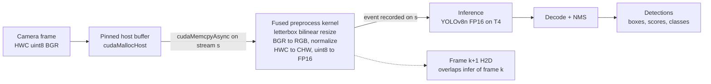

# CUDA-Accelerated Conveyor Waste Detection Pipeline

A CUDA engineering prototype: a conveyor-belt waste detector where every optimisation is
measured with CUDA events, checked against a CPU reference, and written to a CSV by the code
that ran it.

**Status: prototype.** Not deployed, not production, not a state-of-the-art detector. It runs
end to end from one Colab notebook on a free T4.

The rule this repo is built around: *if a benchmark did not run, it does not appear.*
`results/summary.md` is generated from `results/*.csv`, and anything missing shows up as
**NOT RUN** rather than being estimated.

---

## 1. Problem

Recycling sorting lines need detections at camera frame rate. The interesting engineering is
not the model — a pretrained YOLO is good enough — it is the part around it: getting pixels
from a camera into a tensor fast enough that the GPU is not waiting on the CPU, and knowing
*which* of the many possible optimisations actually pays on the hardware you have.

So the pipeline is decomposed into stages that can each be measured, and each stage has a
baseline it must beat:

| Stage | Baseline | Optimised version |
|---|---|---|
| Preprocess | OpenCV + NumPy on CPU, 5 separate passes | one fused CUDA kernel, one pass |
| Inference | PyTorch FP32 | FP16, ONNX Runtime CUDA, TensorRT (stretch) |
| Transport | pageable memory, default stream | pinned buffers, 2–3 streams |
| Scaling | 1 feed, batch 1 | 1/2/4 feeds, batched |

---

## 2. Architecture



Two ideas carry the design:

1. **Fuse the preprocess.** Resize, colour conversion, normalisation, layout change and dtype
   conversion all read and write the same 640×640×3 tensor. Doing them in one pass over
   destination pixels removes the intermediate tensors and four kernel launches, which is why
   the win is mostly avoided memory traffic rather than arithmetic.
2. **Overlap copy with compute.** The host-to-device copy of frame *k+1* runs on a copy stream
   while inference of frame *k* runs on the GPU. This is a real overlap; running two
   inferences concurrently on one backend session is *not* claimed, because most backends
   serialise internally.

---

## 3. Results

Every table lives in [`results/summary.md`](results/summary.md), generated by:

```bash
python tools/summary.py
```

which reads the CSVs written by the benchmarks and emits the tables, including the GPU the
numbers came from. Run it after the notebook; it is the only source of numbers in this repo.

`results/failures.md` records what did not work in the target environment (for example
Nsight Compute on Colab, or a TensorRT install that fights the preinstalled PyTorch), with the
actual error text. Those rows are absent from the tables on purpose.

---

## 4. Layout

```
include/bench_common.h      shared timing (CUDA events), correctness and CSV helpers
phase_a/                    standalone nvcc benchmarks, one binary each
  vector_add.cu             sanity check + bandwidth ceiling
  reduction.cu              global -> shared -> warp shuffle -> CUB
  matmul.cu                 naive -> 32x32 tiled -> cuBLAS
  streams.cu                pageable vs pinned, 1/2/3 streams
phase_b/                    the applied pipeline (Python + one CUDA extension)
  preprocess.cu             the fused kernel
  preprocess_ext.py         torch.utils.cpp_extension build + CPU reference + bench
  backends.py               pt_fp32 / pt_fp16 / ort_cuda / trt_fp16
  infer_bench.py            the inference ladder
  pipeline.py               serial vs pipelined, plus 1/2/4 feeds
  data_prep.py, finetune.py dataset download/convert and the optional light fine-tune
notebooks/run_all.ipynb     the single entry point
results/                    *.csv, summary.md, failures.md, profiling text
docs/kernel_notes.md        why each kernel is faster or slower
tools/summary.py            CSV -> summary.md
```

---

## 5. Reproduce

On Colab (free tier is enough):

1. Upload the repo folder, or set `GIT_URL` in the first cell of the notebook.
2. `Runtime > Change runtime type > Hardware accelerator = T4 GPU`.
3. Open `notebooks/run_all.ipynb` and `Runtime > Run all`.

The notebook installs the matching CUDA toolkit if `nvcc` is absent, builds Phase A with
`make`, builds the preprocess extension, runs the inference ladder, the pipeline and the
batching experiment, then generates and downloads `results/`.

Locally, the same steps by hand:

```bash
make -C phase_a ARCH=sm_75 run        # Phase A -> results/*.csv
python phase_b/preprocess_ext.py      # fused kernel vs CPU
python phase_b/export_model.py
python phase_b/infer_bench.py
python phase_b/pipeline.py
python tools/summary.py
```

`ARCH=sm_75` is a T4 (and a GTX 1650). `ARCH=native` lets `nvcc` detect the local card.

---

## 6. What each optimisation is, and why it should work

Full reasoning, including the parts that turned out to be wrong, is in
[`docs/kernel_notes.md`](docs/kernel_notes.md). Short version:

| Technique | Mechanism | Where it shows up |
|---|---|---|
| 128-bit vector loads (`float4`) | fewer memory transactions and instructions per element | `vector_add.cu` |
| Shared-memory reduction | removes a global round trip per tree level | `reduction.cu` |
| Warp shuffle | removes `__syncthreads()` and shared-memory bank conflicts inside a warp | `reduction.cu` |
| Shared-memory tiling | turns GEMM from memory-bound into compute-bound by reusing a tile 32× | `matmul.cu` |
| Pinned memory | lets the copy engine DMA without a bounce buffer | `streams.cu` |
| Multiple streams | copy of one chunk overlaps compute of another | `streams.cu`, `pipeline.py` |
| Kernel fusion | one pass over destination pixels instead of five over intermediates | `preprocess.cu` |
| FP16 | T4's peak FP16 throughput is roughly 8× its FP32 peak (datasheet figure, not measured here) | `infer_bench.py` |
| Batching | amortises launch overhead, trades latency for throughput | `pipeline.py` |

---

## 7. Honest limitations

- **T4 (sm_75).** No `cp.async`, no TMA, no BF16, no distributed shared memory. Anything that
  relies on Ampere-or-later features is out of scope, and that is a hardware limit, not a
  design choice.
- **Colab is not bare metal.** vCPUs are shared and virtualised, so the CPU baselines are
  noisier and slower than a desktop would be, which *flatters* the GPU speedups. Absolute PCIe
  bandwidth is also below a physical x16 link, and the session can be reclaimed mid-run.
- **The demo footage is looped or synthetic.** There is no camera, and the synthetic generator
  labels itself as such in every CSV row it produces.
- **The detector is essentially pretrained COCO.** Fine-tuning is at most a few epochs on
  whatever box-annotated waste data could be licensed; it is not a trained waste detector.
- **GEMM stops at tiling.** No register blocking or double buffering, so cuBLAS stays well
  ahead. That gap is reported, not hidden.
- **The pipelined loop overlaps copies, not inferences.** See §2.
- **Nsight Compute does not work on Colab** (performance counters need privileges the runtime
  does not grant), so occupancy and memory-throughput counters come from Nsight Systems'
  kernel table plus CUDA events instead.

---

## 8. Data and licences

Dataset choice, licence status and what could and could not be verified are in
[`docs/data_sources.md`](docs/data_sources.md). Licences are recorded as `verified` or
`unverified` — an unverified licence is never presented as cleared for redistribution.
