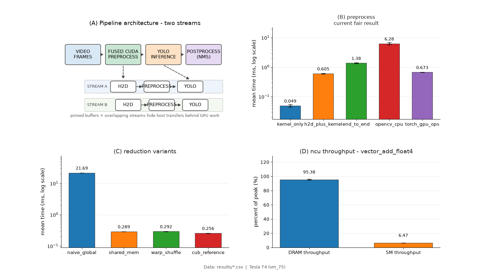
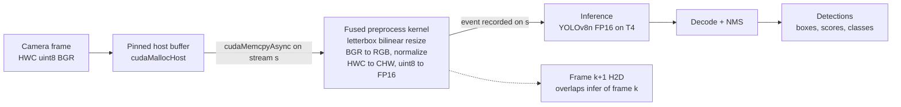

# CUDA-Accelerated Conveyor Waste Detection Pipeline

A CUDA performance study of a conveyor-belt waste detection pipeline: hand-written GPU kernels,
a fine-tuned YOLOv8n, and profiling that shows what got faster and why.



**60-90 s screen demo:** [`demo/demo.mp4`](demo/demo.mp4) - *not rendered yet.* The real 30 s
input (`demo/belt_input.mp4`) and the renderer (`demo/render_demo.py`) are in place; the renderer
refuses to invent numbers and waits for `results/demo_frame_timings.csv` from a T4 run.

> **Status: prototype.** Everything below marked "measured" comes from a CSV. The first CSVs
> came from a synthetic run (archived in `results/synthetic_run1/`); the dataset, fine-tune,
> real-video and re-measured preprocess stages are code-complete but await a T4 run.

**Status: prototype.** Not deployed, not production, not a state-of-the-art detector. It runs
end to end from one Colab notebook on a free T4.

The rule this repo is built around: *if a benchmark did not run, it does not appear.*
`results/summary.md` is generated from `results/*.csv`, and anything missing shows up as
**NOT RUN** rather than being estimated.

---

## 1. Problem

Recycling sorting lines need detections at camera frame rate. The interesting engineering is
not the model — a pretrained YOLO is good enough — it is the part around it: getting pixels
from a camera into a tensor fast enough that the GPU is not waiting on the CPU, and knowing
*which* of the many possible optimisations actually pays on the hardware you have.

So the pipeline is decomposed into stages that can each be measured, and each stage has a
baseline it must beat:

| Stage | Baseline | Optimised version |
|---|---|---|
| Preprocess | OpenCV + NumPy on CPU, 5 separate passes | one fused CUDA kernel, one pass |
| Inference | PyTorch FP32 | FP16, ONNX Runtime CUDA, TensorRT (stretch) |
| Transport | pageable memory, default stream | pinned buffers, 2–3 streams |
| Scaling | 1 feed, batch 1 | 1/2/4 feeds, batched |

---

## 2. Architecture



Two ideas carry the design:

1. **Fuse the preprocess.** Resize, colour conversion, normalisation, layout change and dtype
   conversion all read and write the same 640×640×3 tensor. Doing them in one pass over
   destination pixels removes the intermediate tensors and four kernel launches, which is why
   the win is mostly avoided memory traffic rather than arithmetic.
2. **Overlap copy with compute.** The host-to-device copy of frame *k+1* runs on a copy stream
   while inference of frame *k* runs on the GPU. This is a real overlap; running two
   inferences concurrently on one backend session is *not* claimed, because most backends
   serialise internally.

---

## 3. Results

Every table lives in [`results/summary.md`](results/summary.md), generated by:

```bash
python tools/summary.py
```

which reads the CSVs written by the benchmarks and emits the tables, including the GPU the
numbers came from. Run it after the notebook; it is the only source of numbers in this repo.

The current CSVs are from the first **synthetic** run, archived under
`results/synthetic_run1/`. Its preprocess speedup claim has been withdrawn: the GPU time
excluded the host→device upload while the OpenCV baseline excluded it too, and that
baseline had `max_abs_err=2.1` against the reference. The benchmark has been rewritten to
report five honestly-scoped timings (Task 1), but the new numbers do not exist yet — they
need a T4 run. Nothing here is estimated in the meantime.

`results/failures.md` records what did not work in the target environment (for example
Nsight Compute on Colab, or a TensorRT install that fights the preinstalled PyTorch), with the
actual error text. Those rows are absent from the tables on purpose.

---

## 4. Layout

```
include/bench_common.h      shared timing (CUDA events), correctness and CSV helpers
phase_a/                    standalone nvcc benchmarks, one binary each
  vector_add.cu             sanity check + bandwidth ceiling
  reduction.cu              global -> shared -> warp shuffle -> CUB
  matmul.cu                 naive -> 32x32 tiled -> cuBLAS
  streams.cu                pageable vs pinned, 1/2/3 streams
phase_b/                    the applied pipeline (Python + one CUDA extension)
  preprocess.cu             the fused kernel
  preprocess_ext.py         torch.utils.cpp_extension build + CPU reference + bench
  backends.py               pt_fp32 / pt_fp16 / ort_cuda / trt_fp16
  infer_bench.py            the inference ladder
  pipeline.py               serial vs pipelined, plus 1/2/4 feeds
  data_prep.py, finetune.py dataset download/convert and the optional light fine-tune
notebooks/run_all.ipynb     the single entry point
results/                    *.csv, summary.md, failures.md, profiling text
docs/kernel_notes.md        why each kernel is faster or slower
tools/summary.py            CSV -> summary.md
```

---

## 5. Reproduce

On Colab (free tier is enough):

1. Upload the repo folder, or set `GIT_URL` in the first cell of the notebook.
2. `Runtime > Change runtime type > Hardware accelerator = T4 GPU`.
3. Open `notebooks/run_all.ipynb` and `Runtime > Run all`.

The notebook installs the matching CUDA toolkit if `nvcc` is absent, builds Phase A with
`make`, builds the preprocess extension, runs the inference ladder, the pipeline and the
batching experiment, then generates and downloads `results/`.

Locally, the same steps by hand:

```bash
make -C phase_a ARCH=sm_75 run        # Phase A -> results/*.csv
python phase_b/preprocess_ext.py      # fused kernel vs CPU
python phase_b/export_model.py
python phase_b/infer_bench.py
python phase_b/pipeline.py
python tools/summary.py
```

`ARCH=sm_75` is a T4 (and a GTX 1650). `ARCH=native` lets `nvcc` detect the local card.

---

## 6. What each optimisation was supposed to do, and what happened

Full reasoning, including the parts that turned out to be wrong, is in
[`docs/kernel_notes.md`](docs/kernel_notes.md). Short version — the "measured" column
comes from [`results/summary.md`](results/summary.md), not from expectation:

| Technique | Mechanism | Measured on this T4 | Where |
|---|---|---|---|
| 128-bit loads (`float4`) | fewer memory transactions per element | **no win**: 2.412 ms vs 2.287 ms scalar — both already at ~250–260 GB/s | `vector_add.cu` |
| Shared-memory reduction | removes a global round trip per tree level | 0.290 ms vs **CUB 0.261 ms** (within ~11%); the "80×" figure is only against a deliberately slow one-block baseline | `reduction.cu` |
| Warp shuffle | removes intra-warp barriers and shared traffic | 0.295 ms — essentially tied with shared memory (bandwidth floor) | `reduction.cu` |
| Shared-memory tiling | reuse a tile 32× so GEMM turns compute-bound | 732 vs 667 GFLOP/s; cuBLAS still 6130 | `matmul.cu` |
| Pinned memory | lets the copy engine DMA without a bounce buffer | 11.10 ms vs 31.16 ms pageable (2.81×) | `streams.cu` |
| Multiple streams | copy of one chunk overlaps compute of another | 7.25 ms vs 11.10 ms pinned (1.53× more) | `streams.cu` |
| Kernel fusion | one pass instead of five over intermediates | **withdrawn pending fair re-measurement** — the old 84× compared a GPU-kernel-only time against an un-uploaded CPU time, and that OpenCV row had `max_abs_err=2.1`. Task 1 now adds `kernel_only`, `h2d_plus_kernel`, `end_to_end`, `opencv_cpu` (upload included) and `torch_gpu_ops`, all gated against one reference. | `preprocess.cu` |
| FP16 | tensor cores are ~8× FP32 *peak* on paper | **slower**: 10.030 vs 8.079 ms at batch 1 | `infer_bench.py` |
| ONNX Runtime CUDA | graph optimisation + tuned kernels | 7.916 ms, 1.02× over eager FP32 | `infer_bench.py` |
| Batching / pipeline | amortise launches, overlap copy with infer | serial holds ~106 FPS/feed; pipelined **regresses** at 2/4 feeds | `pipeline.py` |

---

## 7. Honest limitations

- **T4 (sm_75).** No `cp.async`, no TMA, no BF16, no distributed shared memory. Anything that
  relies on Ampere-or-later features is out of scope, and that is a hardware limit, not a
  design choice.
- **Colab is not bare metal.** vCPUs are shared and virtualised, so the CPU baselines are
  noisier and slower than a desktop would be, which *flatters* the GPU speedups. Absolute PCIe
  bandwidth is also below a physical x16 link, and the session can be reclaimed mid-run.
- **The old benchmark CSVs are synthetic** (archived in `results/synthetic_run1/`). The new
  dataset and demo video use real ZeroWaste conveyor frames; new runs must be generated on a
  T4 before those CSVs are replaced.
- **The detector is at most lightly fine-tuned.** A small, scene-disjoint ZeroWaste subset
  (1,415 train / 300 val) exists locally, but no mAP has been measured yet — none is claimed.
  Until a real val run exists, the detector is pretrained COCO.
- **Licence:** the Roboflow API reports CC BY 4.0 for the hosted ZeroWaste copy, resolving the
  conflicting CC BY-NC prose on the web page. This is prototype interview use, not
  redistribution; see `docs/data_sources.md`.
- **GEMM stops at tiling.** No register blocking or double buffering, so cuBLAS stays well
  ahead. That gap is reported, not hidden.
- **The pipelined loop overlaps copies, not inferences.** See §2. At 2 and 4 feeds the
  measured pipelined batch loop is *slower* than serial; the buffer bookkeeping costs more
  than the copy stall it removes on these small tensors.
- **Nsight Compute did work on this Colab runtime**, contrary to the usual
  `ERR_NVGPUCTRPERM` limitation. It reported ~95–96% DRAM throughput, ~99–101% achieved
  occupancy and ~6.7% SM throughput for `vector_add_float4` — direct confirmation that the
  kernel is memory-bound. Its kernel *durations* are instrumentation-inflated (1674 ms for
  a 1M-element add) and are deliberately excluded from `summary.md`. That exclusion is
  enforced in `tools/summary.py` by skipping `profiling_*.csv`.

---

## 8. Data and licences

Dataset choice, licence status and what could and could not be verified are in
[`docs/data_sources.md`](docs/data_sources.md). Licences are recorded as `verified` or
`unverified` — an unverified licence is never presented as cleared for redistribution.
