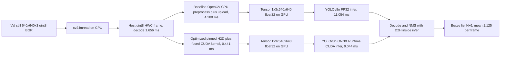

# This project, explained in plain English

For Prateek, final-year CS student, preparing to defend this repo in a CUDA Engineer interview.
This is an explainer, not a script and not a sales pitch. **Every number below comes from a
CSV in `results/` or a line of code in this repo.** Jargon is defined the first time it appears.

> **Update after the fine-tune run:** the detector is no longer only pretrained COCO. A later
> T4 run trained YOLOv8n for 30 epochs on the ZeroWaste subset and wrote a measured mAP50 of
> 0.4173 in `results/finetune.csv`. Both runs are preserved under `results/runs/`; slide 12 of
> the slide pack compares them. Sections below that call fine-tuning "pending" describe the
> earlier pretrained-only run and are kept as the historical baseline.

> **Reviewer corrections (how to read the numbers honestly).** Six points, one line each:
> - **FP16 depends on batch size:** slower than FP32 at batch 1 (13.711 vs 10.932 ms) but ~2×
>   faster at batch 4 (10.285 vs 19.504 ms) and batch 8 (16.658 vs 42.406 ms) — always say which
>   batch (`results/infer.csv`).
> - **Postprocess is 0 by construction:** box decode + NMS and the device-to-host readback are
>   already inside the backend's inference timing, so that column is 0.000 ms, not free work.
> - **Backends:** baseline is PyTorch FP32; optimized tries ONNX Runtime CUDA FP32 then falls back
>   to PyTorch FP32, and the CSV does not record which one the demo loop used.
> - **Agreement excludes empty frames:** the 60 frames with boxes agree at IoU ≈ 1.0; counting the
>   60 empty frames as IoU 0 gave a misleading "50% / 0.500". Corrected: 100%, IoU 1.0 over frames
>   with boxes (`results/pipeline_agreement.csv`).
> - **Pipelining regressed:** in `results/batching.csv` pipelined is slower than serial at every
>   feed count — a measured regression in this prototype, not a speedup.
> - **Preprocess is ~5×, not 84×:** ~1.43 ms end-to-end vs OpenCV CPU 7.20 ms at 1920×1080
>   (~5×), while plain PyTorch GPU ops (~0.684 ms) vs fused H2D + kernel (~0.57 ms) is only ~1.2×;
>   most of the gain is using the GPU, not fusion (`results/preprocess.csv`).

**Where the numbers come from.** The repo holds two measured runs. The first run is archived in
`results/synthetic_run1/*.csv`; its Phase A numbers are the ones quoted in `README.md` and
`docs/kernel_notes.md`, so those are the headline numbers used here. A later re-run wrote
`results/*.csv` with slightly different but consistent values (for example streams pageable
30.37 ms and 3-stream 8.16 ms in `results/streams.csv` versus 31.16 ms and 7.25 ms in
`results/synthetic_run1/streams.csv`; matmul tiled 840 vs 732 GFLOP/s). The demo and preprocess
numbers come from the current `results/*.csv`. Both sets are real measurements; the conclusions
and ratios are the same. Where it matters, both are given.

---

## 1. What this project is, in 5 lines

1. It is a **prototype** CUDA performance study: how fast can we move a conveyor-camera frame into a GPU and through a waste detector, and *why* (`README.md:3-16`, `PRD.md:5-15`).
2. The preserved baseline run detects with **pretrained COCO YOLOv8n** (YOLO = "you only look once", a real-time object detector) on real ZeroWaste stills; the active run uses a 30-epoch fine-tuned YOLOv8n with measured mAP50 0.4173 (`results/finetune.csv`, `results/runs/`).
3. It hand-writes five GPU kernels — vector add, reduction, tiled matmul, streams, fused preprocess — and times each against a fair baseline (`phase_a/*.cu`, `phase_b/preprocess.cu`).
4. On **one Tesla T4** (sm_75, CUDA 13.0, torch 2.14.1+cu130) over 120 real frames, the loop goes 63.9 → 93.0 FPS, a 1.46× speedup (`results/device.json`, `results/demo_frame_timings.csv`).
5. Its limits are part of the story: a small 1,415-train/300-val subset, mAP measured only on that 300-image val split, one GPU, and no deployment claim (`results/dataset.csv`, `results/finetune.csv`).

---

## 2. The pipeline step by step

"Frame in → preprocess → inference → postprocess" is four stages. A **kernel** is a small program
run by many GPU threads at once; a **tensor** is just an array with a shape and a dtype (data
type). HWC means height×width×channel; CHW means channel×height×width — the model wants CHW.
uint8 means an 8-bit integer 0–255; float32 (FP32) is a 32-bit decimal; float16 (FP16) is a
16-bit decimal. H2D = host-to-device copy (CPU RAM → GPU RAM); D2H is the reverse.



All times below are means over the 120 frames in `results/demo_frame_timings.csv`. Both
pipelines use the *same* frames and the *same* weights; only preprocess, backend and upload
change (`phase_b/demo_timings.py:95-106`).

| Stage | Input | Output | Where | Baseline | Optimized |
|---|---|---|---|---|---|
| Decode | `.png` still from `data/waste/images/val` | HWC uint8 BGR array | CPU (`cv2.imread`) | 1.656 ms | 1.656 ms |
| Preprocess | HWC uint8 BGR | `(1,3,640,640)` FP32 RGB NCHW | CPU + `.to("cuda")` vs pinned H2D + CUDA kernel | 4.280 ms | 0.441 ms |
| Inference | `(1,3,640,640)` FP32 GPU | head tensors `(B, 4+nc, H, W)` then boxes | GPU + CPU readback | 11.054 ms, PyTorch FP32 | 9.044 ms, ONNX Runtime CUDA FP32 |
| Postprocess | raw head tensors | `(N,6)` boxes: x1,y1,x2,y2,class,score | CPU-side NMS after D2H | 0.000 ms * | 0.000 ms * |

\* The postprocess column is literally zero in the CSV, not because postprocessing is free but
because decode+NMS and the device-to-host readback are already inside `infer()` — see
`phase_b/backends.py:79-103` and the `extra` field of `results/infer.csv`. The per-frame FPS
column is `1000 / (decode + preprocess + infer)`; its mean is 63.8838 vs 92.9807 FPS, i.e.
**1.46×** (`results/demo_frame_timings.csv`). Mean detections are identical at **1.125 per
frame** (76 of 120 frames had boxes), so the speedup is not from skipping detections.

One honest detail: the clip `demo/belt_input.mp4` is **stitched val stills, not consecutive
video**, and every exported image is already 640×640, so the demo does not exercise
letterboxing at all. The separate preprocess benchmark uses real 1920×1080 and 640×480 inputs
(`docs/data_sources.md:139-157`; `results/preprocess.csv` `src=` field).

---

## 3. Each CUDA piece from scratch

### 3.1 Vector add — `phase_a/vector_add.cu`

**Problem in one sentence:** compute `C[i] = A[i] + B[i]` for 50 million floats and find out
whether wider memory loads help.

**What a GPU thread does** (straight from `phase_a/vector_add.cu:90-98`; the inline comments
are mine):

```cpp
const size_t block_start = blockIdx.x * blockDim.x;  // first element this block owns
const size_t i = block_start + threadIdx.x;          // this thread's own element
if (i >= n) return;                                  // last block may overshoot the array
c[i] = a[i] + b[i];                                  // read A, read B, write C
```

**Why faster/slower.** The operation is one add but 12 bytes moved (4 in from A, 4 in from B,
4 out to C), so it is **memory-bound** — limited by DRAM bytes per second, not arithmetic.
Threads with consecutive indices read consecutive addresses, so one 128-byte cache line serves
a whole **warp** (a group of 32 threads that move in lockstep); that is **coalescing**. The
`float4` variant has one thread load 16 bytes at once (`phase_a/vector_add.cu:102-128`) — fewer
instructions, but the same bytes. **Occupancy** (the fraction of possible warps actually
resident on a streaming multiprocessor, or SM, the GPU's compute unit) is not the limiter.

**Measured:** scalar 2.288 ms / 262.21 GB/s, float4 2.413 ms / 248.62 GB/s —
`results/vector_add.csv` (GB/s = billions of bytes per second). Nsight Compute reported ~95%
DRAM throughput and ~6.5% SM throughput for `vector_add_float4` — `results/profiling_ncu.csv`,
float4 rows. That is direct evidence the kernel is done: ~95% of the memory pipe is busy while
only ~6.5% of the compute pipe is.

### 3.2 Reduction — `phase_a/reduction.cu`

**Problem in one sentence:** sum 2²⁴ = 16,777,216 floats (64 MB) by building a tree of pairwise
adds, and see how much the tree's communication pattern costs.

**What a GPU thread does.** The slow version puts the whole tree in global memory with a
**barrier** (`__syncthreads()`, a point where every thread in the block must wait) at every
level (`phase_a/reduction.cu:160-163`):

```cpp
for (unsigned s = blockDim.x / 2; s > 0; s >>= 1) {  // halve active threads each step
  if (tid < s) scratch[tid] += scratch[tid + s];     // read, add, write in DRAM
  __syncthreads();                                   // everyone waits; next step sees fresh data
}
```

The fast version uses **shared memory** (small on-chip memory, ~100× lower latency than DRAM)
and then **warp shuffle** (a thread reads a neighbour lane's register directly, no memory, no
barrier) — `phase_a/reduction.cu:124-129`:

```cpp
__device__ __forceinline__ float warp_reduce_sum(float v) {  // runs inside one warp
#pragma unroll
  for (unsigned offset = 16; offset > 0; offset >>= 1)       // 5 steps: 16, 8, 4, 2, 1
    v += __shfl_down_sync(0xffffffff, v, offset);            // pull a value from a lane away
  return v;                                                 // lane 0 now holds the warp total
}
```

**Why faster/slower.** `naive_global` uses one block, so one SM works while the other 39 idle,
and each tree level is a full DRAM round trip. `shared_mem` spreads the work over many blocks,
reduces on chip, and sends only one partial per block to DRAM; consecutive indexing avoids
**bank conflicts** (two threads fighting over the same shared-memory bank). Warp shuffle then
removes barriers in the last five steps. After that the kernel hits the bandwidth floor, so
shuffle and shared memory nearly tie.

**Measured** at N=2²⁴: naive 21.690 ms, shared 0.290 ms, warp shuffle 0.295 ms, CUB
(a vendor-tuned library) 0.261 ms — `results/synthetic_run1/reduction.csv`; the later
`results/reduction.csv` gives 21.685 / 0.289 / 0.292 / 0.256 ms. The honest headline is
"within ~11–13% of CUB", not "80× faster" — the 80× figure is only against the deliberately
slow one-block baseline.

### 3.3 Tiled matrix multiply — `phase_a/matmul.cu`

**Problem in one sentence:** compute `C = A·B` for 1024×1024 FP32 matrices and show why
reusing a tile on chip turns a memory-bound loop into a compute-bound one.

**What a GPU thread does.** One thread owns one output cell; each phase it loads a 32×32 tile
of A and B into shared memory, then reuses it 32 times (`phase_a/matmul.cu:153-174`, lines shown
verbatim, comments added):

```cpp
As[threadIdx.y][threadIdx.x] =
    (a_row < n && a_col < n) ? a[static_cast<size_t>(a_row) * n + a_col] : 0.0f;  // tile load, zero past edge
Bs[threadIdx.y][threadIdx.x] =
    (b_row < n && b_col < n) ? b[static_cast<size_t>(b_row) * n + b_col] : 0.0f;  // B stored transposed
__syncthreads();                                                                 // wait until all loads are visible
#pragma unroll
for (int k = 0; k < TILE; ++k)                                                   // 32 steps per phase
  acc += As[threadIdx.y][k] * Bs[k][threadIdx.x];                                // each loaded value reused 32 times
```

**Why faster/slower.** The naive kernel reads B column-wise, so threads in a warp touch
addresses 1024 floats apart — one 32-byte sector per 4-byte value, about 8× wasted bandwidth.
Tiling cuts global traffic ~32×, which is why it wins; the transposed B tile makes the inner
reads conflict-free. GFLOP/s means billions of floating-point operations per second (here
counted as `2·N³` operations, i.e. `N³` multiply-adds). cuBLAS (NVIDIA's tuned library) is far ahead because it adds
register blocking, double buffering and architecture-specific tuning that this 32×32 textbook
kernel deliberately omits.

**Measured** at N=1024: tiled 732 GFLOP/s (2.935 ms) vs cuBLAS 6130 GFLOP/s (0.350 ms), about
**12% of cuBLAS** — `results/synthetic_run1/matmul.csv`; the later `results/matmul.csv` gives
840 vs 6081 GFLOP/s. The gap is reported, not hidden.

### 3.4 Streams and pinned memory — `phase_a/streams.cu`

**Problem in one sentence:** move 64 MiB through four chunks of `H2D copy → kernel → D2H copy`
and find the real source of overlap.

**What a GPU thread does.** The workload kernel is deliberately tiny (`y[i] = a[i]*2+1`) — the
interesting part is the *pipeline* around it. A **stream** is a FIFO queue of GPU work; a
**pinned** buffer is host memory the GPU's DMA (direct memory access) engine can read directly,
without a bounce buffer. `cudaMemcpyAsync` returns immediately. The code puts a chunk's copy,
kernel and copy-back on the same non-blocking stream (`phase_a/streams.cu:215-231`):

```cpp
CUDA_CHECK(cudaMemcpyAsync(d_a, h_a, bytes, cudaMemcpyHostToDevice, s));   // H2D on stream s, returns at once
scale_kernel<<<c.grid, c.block, 0, s>>>(d_a, d_y, c.chunk_floats);         // kernel on same stream, after copy
CUDA_CHECK(cudaMemcpyAsync(h_y, d_y, bytes, cudaMemcpyDeviceToHost, s));   // D2H after the kernel
...
CUDA_CHECK(cudaEventRecord(events[s], streams[s]));                       // mark each stream's tail
CUDA_CHECK(cudaEventSynchronize(events[s]));                              // CPU waits for all streams
```

**Why faster/slower.** Pageable host memory cannot be DMA'd directly, so the driver stages it
through a pinned "bounce buffer" and the copy blocks — nothing overlaps. Pinning removes that
cost; multiple non-blocking streams let the copy engine move chunk *k+1* while the SMs run the
kernel for chunk *k*. Total time is the **maximum** over streams, not their sum, so with only
four chunks the last one runs alone at the tail — that is why 3 streams are not 2× faster than
2. Overlap also needs a **non-blocking stream**: the legacy default stream implicitly
synchronises with other streams.

**Measured** on 64 MiB: pageable 31.16 ms, pinned 11.10 ms, 2 streams 7.36 ms, 3 streams 7.25
ms (4.30×) — `results/synthetic_run1/streams.csv`; the later `results/streams.csv` gives 30.37 /
11.95 / 8.23 / 8.16 ms. Ratios ~2.5× from pinning and ~1.5× more from streams are the honest
reading.

### 3.5 Fused preprocess — `phase_b/preprocess.cu`

**Problem in one sentence:** turn a 1080p BGR uint8 camera frame into a normalised 3×640×640 FP32
RGB tensor without five separate passes over a full-size intermediate.

**What a GPU thread does.** One thread owns one *output* pixel and loops over the three
channels; the four source corners come from the letterbox inverse map, values are blended in
FP32, and the conversion to FP16/FP32 happens only at the store (`phase_b/preprocess.cu:104-149`,
comments added):

```cpp
const int x0f = static_cast<int>(floorf(sx));              // top-left source column
const float wx = sx - static_cast<float>(x0f);             // horizontal blend weight
const float v00 = static_cast<float>(src[base00 + sc]);    // read one corner byte; sc=2-c is BGR to RGB
const float top = fmaf(wx, v01 - v00, v00);                // blend the two top corners
const float v = fmaf(wy, bot - top, top);                  // blend top and bottom
const float centred = v * kInv255 - norm.mean[c];          // subtract mean, in FP32
const float normed = centred * norm.invstd[c];             // divide by std, precomputed as 1/std
dst[c * plane + out_xy] = StoreConvert<T>::run(normed);    // one store into CHW plane c
```

**Why faster/slower.** The CPU path does five passes and moves roughly 30 MB to produce a 2.4 MB
tensor; the fused kernel reads only the source pixels it samples and writes once. It is
**memory-bound**, so the win is avoided traffic and launches, not clever maths. The 32×8 thread
block makes neighbouring threads sample neighbouring pixels (coalesced loads); the maths stays
FP32 so it matches an independent NumPy reference to `max_abs_err=4.768372e-07` before any
timing is allowed (`results/preprocess.csv` `extra` field; `phase_b/preprocess_ext.py:200-279`).
Letterbox geometry is computed on the host so CPU and GPU use identical `scale`/`pad_x`/`pad_y`.

**Measured** at 1920×1080 → 640 (`results/preprocess.csv`): kernel-only 0.049 ms (input already
on GPU, timed with events), pinned H2D + kernel 0.605 ms, end-to-end 1.378 ms (wall clock,
host frame to ready tensor), OpenCV CPU + pageable upload 6.283 ms, plain PyTorch GPU ops
0.673 ms. In the demo loop it is 4.280 → 0.441 ms.

---

## 4. How to read every number and chart

- **Kernel time vs end-to-end.** Kernel time measures one GPU program; end-to-end includes
  decode, uploads, launches, syncs and Python. `kernel_only=0.049 ms` and `end_to_end=1.378 ms`
  are not contradictory — they are different scopes (`results/preprocess.csv`). A good kernel
  time is one that is a small fraction of its end-to-end number.
- **CUDA events.** GPU-written timestamps (`cudaEventRecord`) around one iteration; they measure
  device time and ignore host scheduling jitter. A wall clock around an async launch would only
  measure the launch (`include/bench_common.h:100-161`). Use events for GPU work, wall clock for
  whole-frame work.
- **Warmup.** 5–20 untimed iterations before timing so context setup, module loading and clock
  ramp are not charged to the kernel (`include/bench_common.h:146-150`). A stable run shows no
  first-iteration spike in its samples.
- **Mean / std.** Average and sample standard deviation over N iterations
  (`include/bench_common.h:73-97`); report `mean ± std`, never best-of. A small std relative to
  the mean (e.g. 2.413 ± 0.003 ms, `results/vector_add.csv`) means the measurement is stable.
- **GFLOP/s.** Billions of multiply-adds per second, here `2·N³ / time` (`include/bench_common.h:209-212`). T4 FP32 peak is ~8.1 TFLOP/s = 8100 GFLOP/s (`docs/kernel_notes.md:285`), so 732 is ~9% of peak and cuBLAS's 6130 is ~75% — that is a good interpretation of the gap.
- **GB/s.** Billions of bytes moved per second (`include/bench_common.h:202-205`). T4 HBM is ~320 GB/s (`docs/kernel_notes.md:43`), so 250–262 GB/s in `results/vector_add.csv` is near the ceiling — "good" here means you cannot do better without moving fewer bytes.
- **DRAM vs SM throughput.** Nsight Compute percentages: how busy the memory system vs the compute units are. ~95% DRAM / ~6.5% SM (`results/profiling_ncu.csv`) means memory-bound; the reverse would mean compute-bound. Good practice is to aim the optimisation at the busy unit.
- **Occupancy.** Resident warps divided by the maximum possible — a way to see if latency can be hidden. `vector_add_float4` shows ~97–102% achieved occupancy (`results/profiling_ncu.csv`), yet is still memory-bound: high occupancy is not a goal in itself.
- **FPS per feed.** Total frames per second divided by the number of camera feeds; this decides how many cameras one GPU can serve. `results/batching.csv` reports ~106 FPS/feed for serial at 1/2/4 feeds, but only 110 → 88 → 54 for pipelined.
- **mAP50.** Mean Average Precision at IoU 0.5, the standard detector-quality score (higher is better, 0–1 or 0–100%). **No mAP50 exists for this project**: fine-tuning is planned/pending and `results/finetune.csv` does not exist. The 64.3% on the ZeroWaste page is the *dataset's* number, not ours (`docs/data_sources.md:65-68`).
- **One caveat on FPS.** The demo FPS column is the mean of `1000/(sum of stage times)` per frame, so 63.9 FPS is not exactly `1000/(mean stage sum)` (which is ~58.9). Both are in `results/demo_frame_timings.csv`; use the column's mean when comparing to the README.

---

## 5. Why preprocess is ~10× faster but the loop is only ~1.5× faster

**Amdahl's law** says the speedup of a whole task is limited by the fraction of time the
sped-up part occupied. In the demo, a baseline frame costs 1.656 + 4.280 + 11.054 = 16.99 ms
(decode + preprocess + infer, `results/demo_frame_timings.csv`). The fused kernel cuts
preprocess from 4.280 to 0.441 ms — a 9.7× win that saves 3.84 ms — but that is only ~23% of the
frame. Even *deleting* preprocess entirely would give at most 16.99 / 12.71 ≈ **1.34×**;
replacing it with a 0.441 ms kernel gives ~**1.29×**. The rest of the measured 1.46×
(63.9 → 93.0 FPS) comes from inference also dropping 11.054 → 9.044 ms, i.e. 2.01 ms from the
backend change. Picture two stacked bars: decode 1.656 in both, preprocess 4.280 → 0.441,
inference 11.054 → 9.044. The big-looking 9.7× is a small slice of the first bar, so it cannot
make the whole bar 9.7× shorter. This is exactly why the write-up never claims "10× end-to-end".

---

## 6. What did not work and why

1. **`float4` did not beat scalar loads.** Measured 248.62 vs 262.21 GB/s — the wide-load
   version is slightly *slower* (`results/vector_add.csv`), with ~95% DRAM / ~6.5% SM from
   `results/profiling_ncu.csv`. **Hypothesis (not proven):** both are already at the HBM
   bandwidth ceiling, so issuing fewer instructions cannot make bytes arrive faster. The
   conclusion is that vector add is finished, not that the optimisation failed.
2. **FP16 was slower than FP32 at batch 1.** First run: 10.030 ± 1.057 ms vs 8.079 ± 1.200 ms
   (`results/synthetic_run1/infer.csv`); the later `results/infer.csv` is even more lopsided,
   32.076 ± 17.901 vs 9.395 ± 3.861 ms. **Hypothesis (not proven):** one 640×640 forward at
   batch 1 is launch- and latency-bound, and `model.half()` plus the input cast add work that
   tensor cores cannot repay until batches are larger. Both rows include decode+NMS and D2H, so
   they are comparable (`results/infer.csv` `extra` field).
3. **Pipelining regressed at 2 and 4 feeds.** First run FPS/feed: 110.2 → 72.3 → 37.1 for
   1/2/4 feeds while serial holds ~105–106 (`results/synthetic_run1/batching.csv`); later run:
   109.0 → 87.9 → 53.5 vs serial ~99–109 (`results/batching.csv`). **Hypothesis (not proven):**
   on small 640×640 frames the copy stall is short, so per-slot event bookkeeping and pinned
   buffer occupancy cost more than the overlap saves. The measured win is only ~1.03× for a
   single stream of 300 frames (`results/synthetic_run1/pipeline.csv`), not a 2× pipeline.

---

## 7. Limits of the prototype

- **Dataset.** ZeroWaste v3 `yolov8` export through the Roboflow MCP: source metadata 9,563
  images, but the local subset is **1,415 train / 300 val (1,715 images, 8,895 boxes)** —
  cardboard 5,554, soft_plastic 2,313, rigid_plastic 835, metal 193 (`results/dataset.csv`,
  `docs/data_sources.md:99-133`). Train and val scenes are disjoint. Licence is recorded as CC
  BY 4.0 from the API for prototype use only; re-check before publishing images.
- **No mAP yet.** Fine-tuning is **planned/pending** and was skipped by design to keep the
  inference workload fixed (`results/failures.md:19`); `results/finetune.csv` has not been
  produced. `results/pipeline_agreement.csv` is a per-frame box-count/IoU agreement check
  between the two pipelines, not a detector-quality score. The detector is pretrained COCO YOLOv8n; the
  class numbers in the demo boxes are COCO ids, not waste-trained classes
  (`results/demo_frame_timings.csv` `baseline_boxes` field). No detection-quality claim is made.
- **640×640 clip.** `demo/belt_input.mp4` is stitched val stills, not consecutive video; 450
  dark frames were dropped, leaving 450 frames at 22.5 s / 20 fps (`docs/data_sources.md:139-157`).
  Because every exported image is 640×640, letterboxing is not exercised in the demo — the
  Task 1 preprocess benchmark on 1920×1080 and 640×480 is the only place it is measured.
- **One GPU, one node.** Tesla T4, sm_75, 40 SMs, 14.56 GiB, CUDA 13.0, torch 2.14.1+cu130
  (`results/device.json`). No `cp.async`, TMA, BF16 or distributed shared memory; nothing
  Ampere-or-later is claimed.
- **TensorRT status.** Unavailable: `ModuleNotFoundError: No module named 'tensorrt'`
  (`results/failures.md:10-11`, `:24`). ONNX Runtime CUDA is the highest inference rung that
  actually ran (`results/infer.csv`).
- **What timings include.** `results/infer.csv` is batch 1 only — batch 4/8 produced no rows.
  `results/pipeline.csv` and `results/batching.csv` still say `source=synthetic`. Demo numbers
  are per-frame wall clock with device syncs, postprocess folded into `infer`. Nsight Compute
  durations are inflated by instrumentation and are excluded from `results/summary.md` by
  `tools/summary.py`. Colab's vCPUs and PCIe are virtualised, so absolute bandwidth is below a
  physical x16 link and CPU baselines are pessimistic — the ratios are the reliable part
  (`README.md:200-228`).

---

## 8. Self-test: 10 questions, 2-line answers

**1. What is the end-to-end speedup and on what data?**  
63.9 → 93.0 FPS, 1.46×, over 120 real val stills (`results/demo_frame_timings.csv`). Same frames and same pretrained YOLOv8n in both pipelines.

**2. What changed in preprocess?**  
OpenCV CPU + upload → pinned H2D + one fused CUDA kernel. In the demo that is 4.280 → 0.441 ms (`results/demo_frame_timings.csv`).

**3. What are the two honest preprocess scopes?**  
Kernel-only 0.049 ms and end-to-end 1.378 ms at 1920×1080 (`results/preprocess.csv`). They differ because one excludes and the other includes host work and H2D.

**4. How do we know the speedup is not from fewer detections?**  
Mean detections are 1.125/frame in both, with boxes on 76/120 frames (`results/demo_frame_timings.csv`). The box coordinates also match to ~1e-4.

**5. Why is reduction "only" ~11–13% behind CUB?**  
Shared 0.290 ms and shuffle 0.295 ms vs CUB 0.261 ms at N=2²⁴ (`results/synthetic_run1/reduction.csv`). Once DRAM is read once, there is little left to win.

**6. What does the reduction result actually demonstrate?**  
Naive 21.690 ms → shared 0.290 ms, ~75× (`results/synthetic_run1/reduction.csv`). The win comes from removing global round trips and enabling many SMs, not from faster arithmetic.

**7. What did tiling buy in matmul, and what is missing?**  
732 vs 631 GFLOP/s naive and 6130 GFLOP/s cuBLAS at N=1024 (`results/synthetic_run1/matmul.csv`). Missing: register blocking, double buffering, tensor-core MMA.

**8. What is the streams result and its prerequisite?**  
Pageable 31.16 ms → 3-stream pinned 7.25 ms, 4.30× (`results/synthetic_run1/streams.csv`). Overlap needs pinned RAM plus non-blocking streams plus an async copy.

**9. What is the single most important limit to quote in an interview?**  
Prototype on one T4, 1,415/300-image subset, no mAP yet because fine-tuning is pending (`results/dataset.csv`, `results/failures.md:19`). Never present the COCO detector as a trained waste detector.

**10. Why not 9.7× end-to-end if preprocess is 9.7× faster?**  
Preprocess is ~23% of a 16.99 ms frame, so it can save at most ~1.3× alone (`results/demo_frame_timings.csv`). The measured 1.46× also needs the 2.01 ms inference drop from the backend change.
